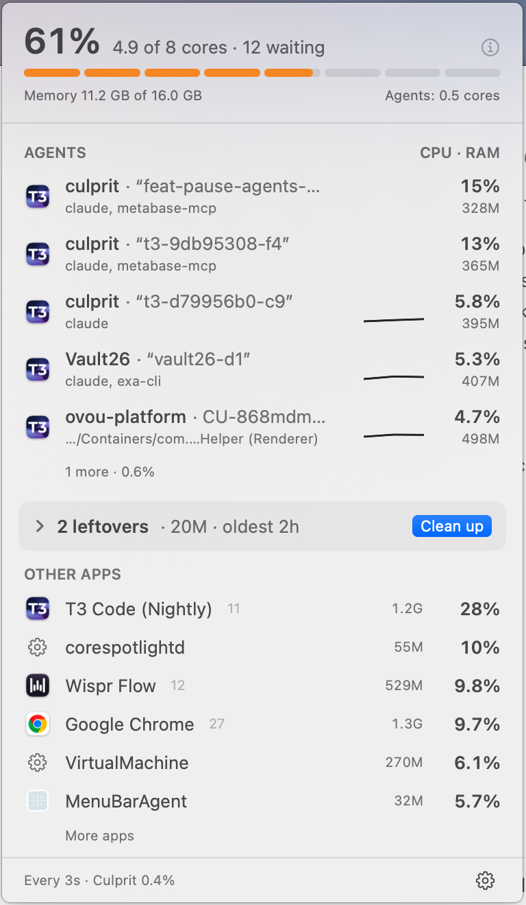

# Culprit

A macOS menu bar app that answers one question: **which agent run is using my CPU right now?**

Activity Monitor shows a wall of `node`, `git` and `vitest`. Culprit groups that load by the
coding-agent session that spawned it (Claude Code, T3 Code) and by the repo, worktree and branch
it runs in. When five agents work in five worktrees of the same repo, you see five rows, not one
pile of `node`.

<p align="center"></p>

## What it does

| Area | |
|---|---|
| Menu bar | How busy the CPU is, in green, orange or red (red also when threads queue up past twice the core count) |
| Agents | One row per agent session: repo, branch, CPU, memory and a sparkline of the last minute. Click a row to see the folders its processes run in; click a folder to open it in Finder |
| Leftovers | Process groups and Docker containers whose session has ended. One button stops them. Processes of live sessions and Culprit itself are never stopped; Compose containers are matched by their worktree folder, so stop leftovers in a worktree a live session is using with care |
| Other apps | Everything else, grouped by the app it belongs to, so Chrome's 28 helpers are one row |
| Footer | Refresh interval, start at login, and Culprit's own CPU |

CPU per row is per core: 100% is one full core, so a busy row can read over 100%.

## Install

Download `Culprit-<version>.zip` from the [latest release](https://github.com/aliir74/culprit/releases/latest),
unzip it and move `Culprit.app` to `/Applications`.

The app is ad-hoc signed, not notarized, so macOS blocks the first launch. Either open
System Settings > Privacy & Security and click **Open Anyway**, or clear the quarantine flag:

```bash
xattr -dr com.apple.quarantine /Applications/Culprit.app
```

Requires macOS 14 or later. The build is universal (Apple silicon and Intel).

## Build from source

```bash
./Scripts/install-app.sh            # build, bundle and install into /Applications
./Scripts/install-app.sh ~/Applications   # or anywhere else
```

Needs Swift 6 (Xcode 16 or later).

## How it works

Attribution comes from `ClaudeTopKit`, the engine of
[claude-top](https://github.com/mbrummerstedt/claude-top). It reads every process with libproc,
walks the process tree up to the agent session that owns it, and reads each process's working
directory to find the repo and worktree. Culprit adds the panel, per-app grouping and the
leftover stopper on top.

The app is not sandboxed: libproc returns `EPERM` for other processes inside the App Sandbox.

## Credits

[claude-top](https://github.com/mbrummerstedt/claude-top) by Martin Brummerstedt (MIT) does the
attribution. Culprit is a different front end over it.

## License

MIT, see [LICENSE](LICENSE).
